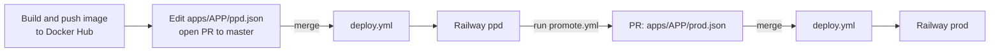

## Apps

| App            | Description  | Docker image                |
| -------------- | ------------ | --------------------------- |
| `api-leetcode` | Backend API  | `ditmar/api-leetcode:<tag>` |
| `leetcode-spa` | Frontend SPA | `ditmar/leetcode-spa:<tag>` |

## Environments

Only two environments exist:

| Environment | Purpose                                             |
| ----------- | --------------------------------------------------- |
| `ppd`       | Pre-production. Every new version goes here first.  |
| `prod`      | Production. Only reachable by promoting from `ppd`. |

The main branch is **`master`**. Both environments live in the same Railway project (`leetcode`).

## Repository layout

```
apps/
  api-leetcode/
    ppd.json
    prod.json
  leetcode-spa/
    ppd.json
    prod.json
scripts/
  validate-image.sh     # checks that the Docker image exists on Docker Hub
  deploy-railway.sh     # updates the image in Railway and triggers the deploy
  promote.sh            # local helper to promote ppd -> prod
.github/workflows/
  deploy.yml            # Deploy to Railway
  promote.yml           # Promote Between Environments
  rollback.yml          # Rollback Environment
```

### Environment file: `apps/<app>/<env>.json`

```json
{
  "app": "api-leetcode",
  "environment": "ppd",
  "image": "ditmar/api-leetcode:0.1.0",
  "railwayProject": "leetcode",
  "railwayProjectId": "...",
  "railwayEnvironment": "ppd",
  "railwayEnvironmentId": "...",
  "railwayService": "api-leetcode",
  "railwayServiceId": "...",
  "deployedAt": "2026-06-30T22:30:00Z",
  "deployedBy": "PCilverio",
  "commitSha": "pending",
  "notes": "Initial pre-production slot setup for API service deployment"
}
```

| Field                                            | Who edits it                                                  | Meaning                                                                                                                                                                                                  |
| ------------------------------------------------ | ------------------------------------------------------------- | -------------------------------------------------------------------------------------------------------------------------------------------------------------------------------------------------------- |
| `image`                                          | **You**                                                       | Docker image and tag to deploy. Never use `latest`.                                                                                                                                                      |
| `railway*` fields                                | Nobody (set once)                                             | Identify the Railway project, environment and service.                                                                                                                                                   |
| `deployedAt`, `deployedBy`, `commitSha`, `notes` | Automation (`deploy-railway.sh`, `promote.yml`, `promote.sh`) | Audit information about the last deploy. `commitSha` is the commit of **this repo** that triggered the deploy (not the app's source commit). `pending` means it has never been deployed by the pipeline. |

## Secrets

| Secret              | Used by                     | Purpose                                                             |
| ------------------- | --------------------------- | ------------------------------------------------------------------- |
| `RAILWAY_API_TOKEN` | `deploy.yml`                | Authenticates against the Railway API.                              |
| `GITHUB_TOKEN`      | `deploy.yml`, `promote.yml` | Provided automatically by GitHub (push metadata commits, open PRs). |

Docker images must be **public** on Docker Hub. `validate-image.sh` can read `DOCKERHUB_USERNAME` and `DOCKERHUB_TOKEN` for private images, but the workflows do not pass them today.

## Flow



Step 1 is manual today: the application repositories do not update this repo automatically.

What `deploy.yml` does when `apps/**/ppd.json` or `apps/**/prod.json` changes on `master`:

1. Detects which environment files changed.
2. Waits for approval if the GitHub Environment (`ppd` / `prod`) requires it.
3. Validates that the Docker image exists on Docker Hub (`scripts/validate-image.sh`) and that the tag is not `latest`.
4. Updates the image of the Railway service and triggers a deploy (`scripts/deploy-railway.sh`).
5. Commits the updated metadata back to `master` (`[skip ci]`).

## How do I deploy a new version?

### Deploy to `ppd`

1. Build and push the image to Docker Hub with a concrete tag, for example `ditmar/api-leetcode:0.2.0`.
2. Create a branch and edit the `image` field in `apps/<app>/ppd.json`:

   ```diff
   - "image": "ditmar/api-leetcode:0.1.0",
   + "image": "ditmar/api-leetcode:0.2.0",
   ```

3. Open a pull request to `master` and merge it.
4. Open the **Actions** tab, find the **Deploy to Railway** run and approve the `ppd` environment if GitHub asks for it.
5. When the run is green, the new version is live in Railway `ppd`, and `apps/<app>/ppd.json` has fresh `deployedAt` / `deployedBy` values.

You can also deploy without a PR: **Actions → Deploy to Railway → Run workflow**, then enter `app` (for example `api-leetcode`) and `environment` (`ppd`). This redeploys whatever image the file currently has.

### Promote `ppd` to `prod`

1. Go to **Actions → Promote Between Environments → Run workflow**.
2. Enter `app` (`api-leetcode` or `leetcode-spa`), `ppd` as origin, `prod` as destination, and optional notes.
3. The workflow copies the `ppd` image into `apps/<app>/prod.json` and opens a PR from branch `promote/<app>/ppd-to-prod`.
4. Review the checklist in the PR, then merge it. `deploy.yml` deploys to `prod`.

Local alternative (edits the file only, you still open the PR yourself):

```bash
./scripts/promote.sh api-leetcode ppd prod
```

Rules enforced by both the script and the workflow:

- The only valid promotion is `ppd` to `prod`.
- A `latest` tag cannot be promoted.
- If `prod` already has the same image, nothing happens.

## How do I roll back?

**Actions → Rollback Environment → Run workflow**, then fill in:

| Input         | Value                                                                   |
| ------------- | ----------------------------------------------------------------------- |
| `app`         | `api-leetcode` or `leetcode-spa`                                        |
| `environment` | `ppd` or `prod`                                                         |
| `strategy`    | `manual-tag` (recommended) or `git-history`                             |
| `target_tag`  | Tag to restore, for example `0.1.0` (only for `manual-tag`)             |
| `reason`      | Why you are rolling back (required, saved in the commit and in `notes`) |

What it does: finds the target image, checks that it exists on Docker Hub, updates `apps/<app>/<env>.json`, deploys to Railway and **commits straight to `master`** (no PR). The GitHub Environment (`ppd` / `prod`) can require approval before it starts.

- `manual-tag` keeps the current image name and only swaps the tag. Use it whenever you know the version you want back.
- `git-history` takes the second most recent commit that touched the file. Deploy metadata commits also touch that file, so it may pick the image that is already running. Check the "Rollback plan" step output before relying on it.

Rolling back through a PR is also possible: restore an older `image` value in the JSON file and merge it like any other change.

## Test locally without deploying

`deploy-railway.sh` supports a dry run: it reads the file, validates the image and stops before calling Railway.

```bash
DRY_RUN=true RAILWAY_API_TOKEN=dummy ./scripts/deploy-railway.sh apps/api-leetcode/ppd.json
```

Requires `jq` and `curl`.

## Troubleshooting

| Symptom                                            | Likely cause                                                                            |
| -------------------------------------------------- | --------------------------------------------------------------------------------------- |
| `Config de origen no encontrado`                   | The `app` name is wrong. It must match a folder in `apps/`.                             |
| Deploy did not start after merging                 | The PR did not modify `apps/**/ppd.json` or `apps/**/prod.json`.                        |
| Image validation fails                             | The tag does not exist on Docker Hub, or it is `latest`. Check the spelling.            |
| Rollback did nothing (same image before and after) | `strategy=git-history` picked the current image. Run it again with `manual-tag`.        |
| Promote workflow cannot open the PR                | Enable "Allow GitHub Actions to create and approve pull requests" in the repo settings. |
